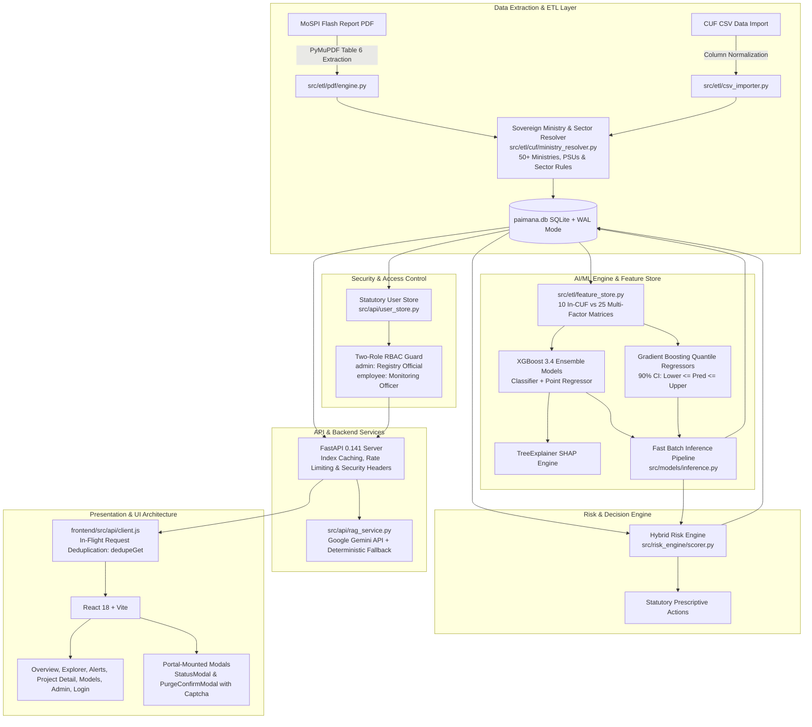

# Architecture & Data Flow
## PAIMANA AI — MoSPI Central Sector Project Intelligence

This document provides a comprehensive technical map of system integrations, module boundaries, architectural data flows, and security domains.

For API contracts, see [API_REFERENCE.md](file:///c:/Users/ayush/OneDrive/Desktop/Web-based-PM/API_REFERENCE.md). For schema details, see [04_Backend_Schema.md](file:///c:/Users/ayush/OneDrive/Desktop/Web-based-PM/04_Backend_Schema.md). For security, see [SECURITY_DATA_GOVERNANCE.md](file:///c:/Users/ayush/OneDrive/Desktop/Web-based-PM/SECURITY_DATA_GOVERNANCE.md).

---

## 1. High-Level Component Architecture

---

## 2. Directory & Module Boundaries

- `src/etl/`:
  - `cuf/ministry_resolver.py` & `cuf/ministry_data.py`: Centralized heuristic and alias resolution engine mapping over 50 central ministries, PSUs, and sector domains with strict word-boundary matching.
  - `pdf/engine.py` & `pdf/sanitizer.py`: PyMuPDF layout-aware tabular extraction parsing Table 6 of MoSPI reports.
  - `csv_importer.py`: Universal CSV adapter supporting diverse agency formats.
  - `feature_store.py`: Builds multi-factor and In-CUF temporal feature matrices.
- `src/models/`:
  - `train_and_evaluate.py`: Model training, out-of-time chronological validation, and conformal interval calibration.
  - `inference.py`: Production-grade batch and single-project inference (`run_fast_inference`), populating `model_predictions` with versioning and timestamps.
- `src/risk_engine/`:
  - `scorer.py`: Computes calibrated composite risk scores ($0.0 - 100.0$) and generates statutory early warning alerts. Refined `is_on_track` heuristics prevent false penalties on verified on-track projects.
- `src/api/`:
  - `main.py`: Modular FastAPI entrypoint orchestrating routers, rate limiting, and CORS.
  - `db.py`: Connection pool manager with automated WAL pragma, retry loops, and idempotent one-time index verification (`_ensure_indexes_once`).
  - `user_store.py`: Persistent SQLite storage for authenticated officers with automatic schema migration and seed accounts.
  - `auth.py`: Token generation, password hashing (PBKDF2/SHA-256), and role dependency guards (`require_role`).
  - `routers/`: Distinct modular routes for `admin`, `alerts`, `assistant`, `auth`, `dashboard`, `export_report`, `filters`, `health`, `import_reports`, `models`, and `projects`.
- `frontend/src/`:
  - `api/client.js`: Centralized Axios HTTP client with Bearer token injection and active request deduplication (`dedupeGet`).
  - `pages/`: Lazy-loaded routed views (`OverviewPage`, `ExplorerPage`, `ProjectDetailPage`, `AlertsPage`, `ModelComparisonPage`, `AdminPage`, `LoginPage`).
  - `components/`: Modular reusable components, including Portal-mounted `StatusModal` and `PurgeConfirmModal`.

---

## 3. Key Design Patterns & Engineering Highlights

1. **Sovereign Ministry & Sector Resolution**:
   - 4-stage cascaded matching: (1) Explicit ministry name / alias $\rightarrow$ (2) Sector domain $\rightarrow$ (3) Implementing agency acronym (NHAI, RVNL, IOCL, etc.) $\rightarrow$ (4) Project title keyword heuristics.
   - Word-boundary regexes prevent false-positive matches (e.g. `empowerment` does not match `power`, `broadband` does not match `road`).
2. **Two-Role Role-Based Access Control (RBAC)**:
   - `admin` (MoSPI Registry Official): Full clearance to manage user rosters, provision accounts, toggle activation states, purge datasets, and review/acknowledge alerts.
   - `employee` (Monitoring Officer): Access to view dashboards, search projects, and query the AI assistant.
3. **High-Assurance Destructive Safeguards**:
   - Database purge actions require solving a client-side 6-character dynamic captcha challenge inside a modal mounted via React Portal.
4. **Client-Side Request Deduplication**:
   - `dedupeGet` in `client.js` maintains an in-flight Promise map, eliminating redundant HTTP calls when multiple dashboard widgets mount concurrently.
5. **Database Connection Index Caching**:
   - `_ensure_indexes_once` runs once at startup rather than on every SQLite connection acquire, drastically cutting overhead under high request throughput.

---

## 4. Third-Party Integrations
- **Google Gemini API**: Grounded conversational project intelligence (`gemini-3.6-flash` with fallback to `gemini-3.5-flash-lite`). Automatically fails over to local deterministic SQL aggregation when offline or unconfigured.
- **PyMuPDF (fitz)**: Native C-backed PDF parsing engine used for layout-aware table extraction.
- **XGBoost & Scikit-Learn**: Machine learning classification, regression, and quantile intervals.
- **TreeSHAP**: Game-theoretic local feature attribution for operational explainability.

